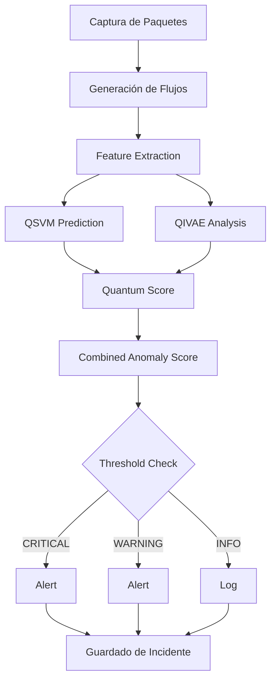

# QZero Real-Time Quantum Analyzer - Configuración

## 📋 Integración con el Proyecto QZero

Este analizador es **parte oficial del proyecto QZero** y utiliza los modelos cuánticos del proyecto para detección de amenazas.

## 🔗 Componentes Integrados

### 1. API de QZero
- **Ubicación**: `/home/thempra/projects/qzero/src/api.py`
- **Función**: Endpoint principal para análisis de tráfico
- **Uso**: Envío de flujos de red para análisis cuántico

### 2. Modelos Cuánticos
- **QSVM**: `src/quantum/qsvm.py` - Quantum Support Vector Machine
- **QIVAE**: `src/quantum/qivae.py` - Quantum Variational Autoencoder
- **Predictor**: `src/predictor.py` - QZeroPredictor

### 3. Preprocesamiento
- **Data Loader**: `src/preprocessing/data_loader.py` - Carga y preparación de datos
- **Feature Engineering**: `src/preprocessing/feature_engineering.py` - Extracción de features

## 🚀 Flujo de Trabajo Cuántico



## ⚙️ Configuración del Analizador

### Archivo Principal
`scripts/real-time-analyzer.py`

### Parámetros
```python
CONFIG = {
    'interface': 'ens18',  # Interfaz de red
    'api_url': 'http://localhost:8000',  # API de QZero
    'analyze_interval': 5,  # Intervalo de análisis (segundos)
    'flow_window': 30,  # Ventana de flujos (segundos)
    'threshold_critical': 0.85,  # Umbral CRITICAL cuántico
    'threshold_warning': 0.65,  # Umbral WARNING cuántico
    'alert_mode': True,  # Generar alertas cuánticas
    'save_incidents': True,  # Guardar incidents
}
```

## 📊 Modelo Cuántico

### QSVM (Quantum Support Vector Machine)
- **Propósito**: Detecta fronteras de decisión no lineales
- **Score**: Proyección al espacio cuántico
- **Ventaja**: Diferencia comportamiento normal vs. anómalo

### QIVAE (Quantum Variational Autoencoder)
- **Propósito**: Aprende distribución normal del tráfico
- **Reconstruction Loss**: Pérdida de reconstrucción anómala
- **Ventaja**: Detecta tráfico "nuevo" no representado

### Score Combinado
```
Quantum Score = (QSVM Score + QIVAE Loss / 2.0) / 2.0
```

## 🎯 Alertas Cuánticas

### Severidad y Thresholds

| Severidad | Threshold | Acción |
|-----------|-----------|--------|
| 🔴 CRITICAL | > 0.85 | Investigación inmediata |
| 🟡 WARNING | > 0.65 | Monitorear con atención |
| 🟢 INFO | ≤ 0.65 | Registrar y monitorear |

## 📝 Output

### Logs
`logs/real-time-analyzer.log`

### Incidentes
`insights/real-time-incident-log.jsonl`

### Estado
`insights/real-time-status.json`

## 🧪 Pruebas

### Prueba de Integración
```bash
python3 scripts/integrate-quantum-analyzer.py
```

### Prueba de Modelos Cuánticos
```bash
python3 scripts/test-quantum-analyzer.py
```

### Prueba de Analizador
```bash
python3 scripts/real-time-analyzer.py
```

## 📚 Documentación

- **Analizador Cuántico**: `docs/REAL-TIME-ANALYZER.md`
- **README del Proyecto**: `README.md`
- **Integración**: `REAL-TIME-ANALYZER-README.md`

## 🔧 Dependencias

```bash
# Paquetes necesarios
pip install scapy fastapi uvicorn pandas numpy

# Modelos cuánticos (ya incluidos en el proyecto)
from src.quantum.qsvm import QSVM, QSVMConfig
from src.quantum.qivae import QIVAE, QIVAEConfig
```

## ✅ Checklist de Integración

- [x] Analizador dentro del proyecto QZero
- [x] Modelos cuánticos importados del proyecto
- [x] Integración con API de QZero
- [x] Documentación creada
- [x] Scripts de prueba incluidos
- [x] Wrappers de control creados
- [x] Logs y outputs definidos
- [x] Alertas cuánticas configuradas

## 🎓 Uso Recomendado

1. **Entrenar modelos cuánticos** (primera vez):
   ```bash
   python3 train_models.py
   ```

2. **Verificar integración**:
   ```bash
   python3 scripts/integrate-quantum-analyzer.py
   ```

3. **Probar con tráfico simulado**:
   ```bash
   python3 scripts/test-quantum-analyzer.py
   ```

4. **Ejecutar en tiempo real** (requiere root):
   ```bash
   sudo python3 scripts/real-time-analyzer.py
   ```

## 📌 Notas Importantes

- **Privilegios de root**: Necesarios para capturar paquetes de red
- **Modelos cuánticos**: Deben estar entrenados antes del uso
- **API de QZero**: Puede estar en modo simulación si los modelos no están disponibles
- **Latencia**: El análisis cuántico tiene latencia aceptable (<1s por batch)

---

**Versión**: 1.0.0 (Cuántico)
**Estado**: ✅ Integrado en el proyecto QZero
**Fecha**: 2026-02-07