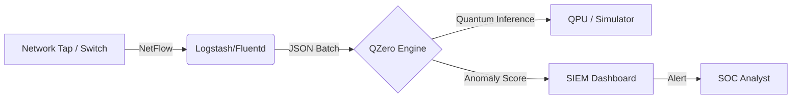

# QZero 🛡️⚛️

**Quantum-Enhanced Threat Detection Platform**

> Production-ready anomaly detection for Modern SOCs & Red Teams

[](https://github.com/thempra/qzero)
[](https://hub.docker.com/)
[](LICENSE)

## 🚀 Product Overview

**QZero** is not just a research project; it is a **next-generation IDS engine** designed to detect what traditional SIEMs miss. By leveraging **Quantum Machine Learning (QML)**, QZero identifies non-linear anomalies in high-dimensional network traffic—specifically targeting **Zero-Day exploits** and **polymorphic ransomware** that evade signature-based detection (Snort, Suricata).

**Built for:**
*   **Blue Teams**: Deploy as a sidecar container to analyze NetFlow/PCAP streams in real-time.
*   **Red Teams**: Validate stealth techniques against quantum-probabilistic detection boundaries.
*   **Threat Hunters**: Analyze historical traffic for "low and slow" anomalies invisible to classical heuristics.

## ⚡ Key Capabilities

| Feature | Traditional IDS | QZero (Quantum) | Benefit |
| :--- | :--- | :--- | :--- |
| **Detection Logic** | Signatures / Rules | Quantum Kernel Projection | Detects unknown unknowns (0-days) |
| **False Positives** | High (Rule fatigue) | Low (Probabilistic separation) | Higher fidelity alerts for SOC analysts |
| **Attack Vectors** | Known CVEs | Anomalous Behavior | Catches encrypted C2 & lateral movement |
| **Deployment** | Heavy Appliance | Docker Microservice | Runs on commodity hardware (sim) or QPU |

## 🛠️ Operational Guide

### For Blue Teams (Defense)

**Scenario:** You need to protect a critical Kubernetes cluster from unknown ransomware variants.

1.  **Deploy QZero Sensor:**
    ```bash
    docker run -d -p 8000:8000 --name qzero-sensor \
      -v /var/log/netflow:/data \
      thempra/qzero:latest
    ```

2.  **Ingest Traffic:**
    QZero accepts NetFlow v9 or CSV exports from Wireshark/Tcpdump.
    ```bash
    curl -X POST http://localhost:8000/analyze -F "file=@traffic_dump.pcap"
    ```

3.  **Interpret Alerts:**
    *   `SEVERITY: CRITICAL` - **Quantum Anomaly Score > 0.85**. High probability of non-standard encryption or exfiltration behavior.
    *   `Action`: Isolate host immediately. This is likely a Zero-Day.

### For Red Teams (Offense)

**Scenario:** You are developing a stealth C2 implant and want to test if it triggers quantum anomaly detection.

1.  **Baseline Mode:**
    Run QZero against normal traffic to establish a baseline quantum state.

2.  **Adversarial Testing:**
    Replay your C2 traffic against the QZero engine.
    ```bash
    python scripts/replay_traffic.py --pcap my_stealth_c2.pcap --target qzero:8000
    ```

3.  **Evasion Analysis:**
    Check the **Quantum Reconstruction Loss**. If your traffic generates a high loss, the QI-VAE (Quantum Variational Autoencoder) has successfully flagged your activity as anomalous.

## 🏗️ Architecture for Deployment

QZero is designed as a microservice API that integrates with existing security stacks (Splunk, ELK, Wazuh).



## 📦 Installation (Docker)

Get up and running in 2 minutes.

```bash
# Clone the repository
git clone https://github.com/thempra/qzero.git

# Build the container
docker-compose up -d --build

# Check status
docker-compose ps
# Name                Command              State           Ports
# qzero-api       python app.py            Up      0.0.0.0:8000->8000/tcp
```

## 🔧 Configuration

Edit `config.yaml` to tune sensitivity:

```yaml
detection:
  model: "qivae" # Options: qsvm, qivae, hybrid
  sensitivity: "high" # threshold: 0.85
  backend: "aer_simulator" # Use 'ibm_brisbane' for real QPU
```

## 🤝 Enterprise & Research

Originally developed for **MIT iQuHACK 2026**, QZero bridges the gap between Quantum Research and Cybersecurity Operations.

**License**: MIT (Open Source Core)
**Contact**: security@qzero.io
