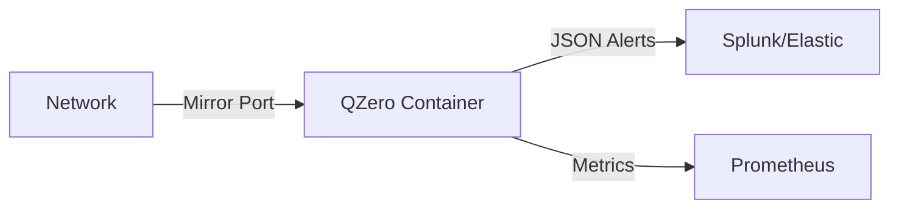

# QZero Operations Manual: Blue Team (Defense)

## 🛡️ Introduction

QZero serves as a **Quantum-Enhanced Anomaly Detection System** designed to sit alongside your existing IDS/SIEM stack. Unlike signature-based systems (Snort, Suricata) that look for known byte sequences, QZero analyzes the **behavioral geometry** of network flows in a high-dimensional quantum feature space.

**Best Use Case:** Detecting Zero-Day exploits, polymorphic C2 channels, and "low and slow" data exfiltration that bypass classical thresholds.

## 🏗️ Deployment Architecture

QZero is designed to be deployed as a **network sensor** or **analyst sidecar**.

### Deployment Option A: Real-time Sensor (Sidecar)

Deploy QZero effectively as a "Quantum Pre-processor" for your SIEM.

1.  **Traffic Source:** Configure your core switch to SPAN/Mirror traffic to the QZero sensor interface, or use a soft-tap (e.g., `daemonlogger`).
2.  **Ingestion:** QZero listens for NetFlow v9/IPFIX or PCAP streams.
3.  **Output:** JSON alerts sent to Splunk/ELK via HTTP HEC or Syslog.



### Deployment Option B: Forensic Analysis

Use QZero to analyze captured traffic from a suspicious incident.

```bash
# Analyze a specific PCAP file
docker run -v $(pwd)/captures:/data thempra/qzero \
  qzero-analyze --input /data/incident_20260128.pcap --format pcap --out /data/report.json
```

## ⚙️ Configuration Tuning

The core trade-off in QZero is **Sensitivity vs. False Positives**. This is controlled by the `quantum_threshold`.

### `config.yaml`

```yaml
detection:
  # 'qsvm' (faster, classification) or 'qivae' (slower, pure anomaly detection)
  model: "qivae" 
  
  # Anomaly score threshold (0.0 - 1.0). 
  # Higher = Less sensitive, fewer False Positives.
  # Lower = More sensitive, catches subtle C2, more Noise.
  # Recommended for production: 0.85
  sensitivity: 0.85
  
  # Window size for flow aggregation (seconds)
  flow_window: 30
```

## 🚨 Interpreting Alerts

QZero alerts differ from standard IDS alerts. They provide a **Quantum Anomaly Score** (QAS).

**Example Alert:**

```json
{
  "timestamp": "2026-01-28T14:22:01Z",
  "src_ip": "10.0.5.22",
  "dst_ip": "192.168.1.5",
  "q_score": 0.92,
  "confidence": "HIGH",
  "reason": "Non-linear manifold deviation (QI-VAE)",
  "flow_meta": {
    "bytes_out": 450,
    "bytes_in": 2200,
    "duration": 1200
  }
}
```

**Playbook:**

1.  **QAS > 0.90 (Critical):** Immediate host isolation. High probability of unknown C2 or Ransomware encryption phase.
2.  **QAS 0.75 - 0.90 (Warning):** Correlate with Endpoint logs (EDR). Check for unauthorized process execution.
3.  **QAS < 0.75 (Info):** Log for behavioral baselining.

## 🔄 Model Retraining

QZero models drift over time as network behavior changes.

**Weekly Routine:**
1.  Feed "known good" traffic (e.g., Monday morning backup traffic) to the training endpoint.
2.  `POST /api/v1/train/update` with the clean dataset.
3.  This updates the **Quantum Kernel** reference state.

## ⚠️ Known Limitations

*   **Encrypted Payload:** QZero analyzes *traffic behavior* (packet timing, size distributions), not payload content. It works on TLS traffic.
*   **Throughput:** Running `aer_simulator` (Quantum Simulator) is CPU intensive. For >1Gbps links, deploy multiple worker nodes behind a load balancer.
